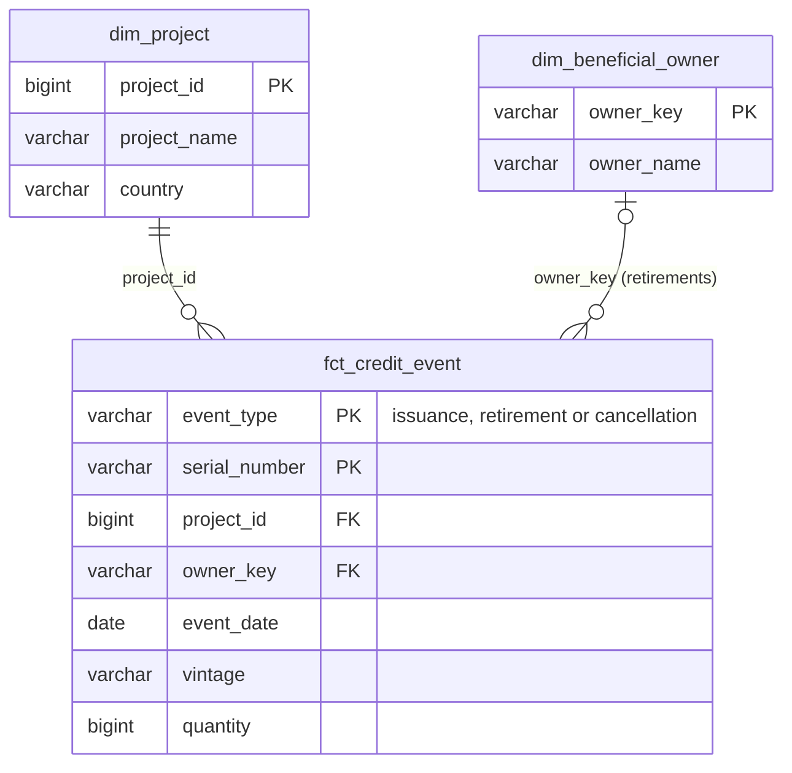
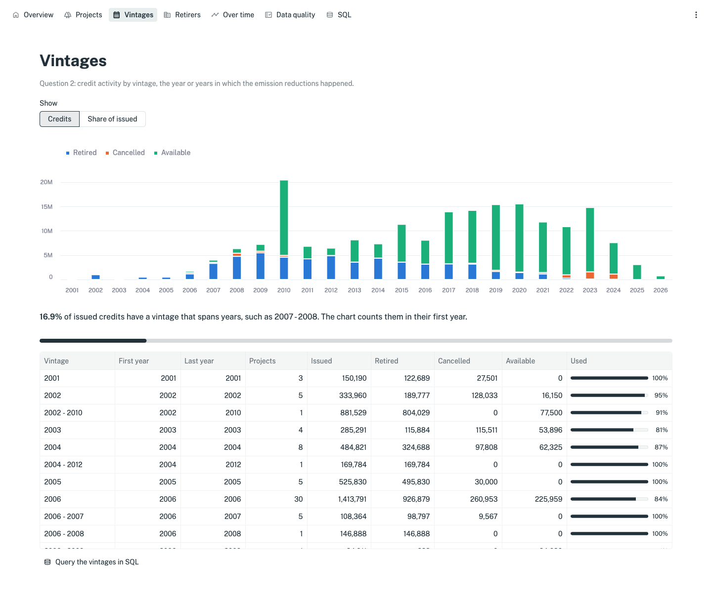
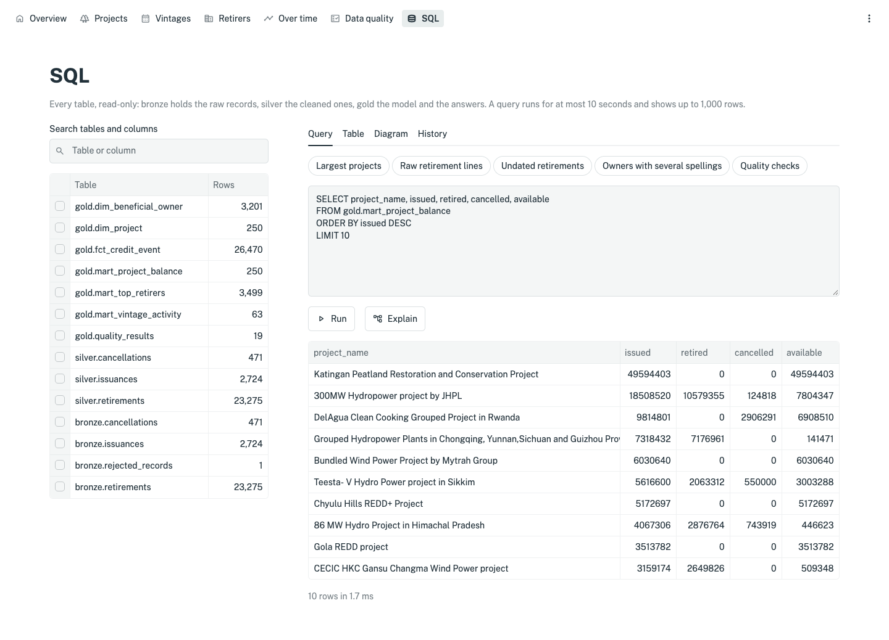

# Verra Registry Pipeline

**Live dashboard:** https://verra-dashboard-480199239724.us-central1.run.app (on Google Cloud; after a quiet spell, the first visit takes a few seconds to start)

Turns Verra's daily carbon-credit exports into clean, tested tables, with a dashboard that answers three questions:

1. For each project, how much was issued, retired and cancelled, and how much is still available?
2. How does credit activity break down by vintage?
3. Who retires the most credits, and what do they retire?

A credit stands for one tonne of CO₂ reduced or removed. It is **retired** when someone uses it to offset their emissions, and **cancelled** when it's taken out of use for any other reason. Its **vintage** is the year the reduction happened.


## Quick start

You need [uv](https://docs.astral.sh/uv/) and `make`. uv installs Python 3.13 if it's missing.

```bash
make setup       # install the locked dependencies
make build       # build every table from the files in data/landing (about a second)
make dashboard   # open http://localhost:8501
make check       # lint, type-check and run the 70 tests
```

`make` on its own lists every command. Step by step, with what you should see, Docker and the cloud: [how to run it](docs/sop.md).

## The answers, for the 2026-11-17 snapshot

| | |
|---|---|
| Projects | 250: 110 have retirements, 33 have cancellations |
| Issued | 198,511,826 credits |
| Retired | 56,564,196 |
| Cancelled | 6,123,377 |
| Still available | 135,824,253 (68.4% of issued) |
| Largest retirers | Interface, Inc. 745,954 · Brisbane City Council 712,027 · Delta Air Lines 644,713 |
| Retired with no named owner | 39,846,198 (70.4% of retired) |

**Why you can trust them:**
- **Nothing is lost.** Every record read is either loaded or set aside with its reason, and keeps its file and line.
- **Every layer adds up** to the one before it. If one doesn't, nothing is written.
- **Every retired credit traces back** to the batch it was issued in, and none is used twice.
- **They were worked out twice.** The [data analysis](docs/data-analysis.md) found them first, with its own SQL, and a test holds the pipeline to them. They share only the file reader, which `analysis/files.py` checks byte by byte.

## How it works


`make build` does everything in memory, and writes only when every check passes:

1. **Landing:** Verra's raw files. They're only ever read.
2. **Bronze:** every record exactly as delivered, plus the file and line it came from. A record that can't be read goes to `bronze.rejected_records`, with the reason.
3. **Silver:** every value read and cleaned: dates, numbers, owner names. No row is dropped. A value that can't be read becomes empty (NULL).
4. **Gold:** the tables you query, including one per question.
5. **Quality gate:** 19 checks. If one that guards a number fails, nothing is written.

It writes to `lake/`, one Parquet file per table and day. Building the same files again gives the same bytes. More: [how a build works](docs/pipeline.md).

## The data model



| Table | One row per | Key | Relations |
|---|---|---|---|
| `gold.fct_credit_event` | issuance, retirement or cancellation | `event_type` + `serial_number` | `project_id` → `dim_project`. `owner_key` → `dim_beneficial_owner`, for retirements. |
| `gold.dim_project` | project | `project_id` | Each project's most common details |
| `gold.dim_beneficial_owner` | owner, every spelling merged | `owner_key` | `unspecified` holds blank and placeholder owners |
| `gold.mart_project_balance` | project | `project_id` | Question 1 |
| `gold.mart_vintage_activity` | vintage, as Verra writes it | `vintage` | Question 2 |
| `gold.mart_top_retirers` | owner and project | `owner_key` + `project_id` | Question 3 |
| `gold.quality_results` | quality check | `check_name` | What the gate found |
| `silver.*` and `bronze.*` | record in a raw file | `_source_file` + `_source_line` | The way back to the raw line |

A retirement or cancellation shares its `batch_id` with the issuance its credits came from. Every total is `sum(quantity)` over the fact table. More: [the data model](docs/data-model.md).

## What the data analysis found

Before any cleaning was written, every line of the three files was read and profiled. The scripts are in [`analysis/`](analysis), and `make analysis` re-runs them. What shaped the pipeline most:

- **The files are messy:** a byte-order mark, a cut-off last record, Windows line endings, and line breaks inside fields.
- **Dates come in two formats** (`19 Mar 2009` and `01-Apr-09`), and 19 retirements have none.
- **16.9% of issued credits have a multi-year vintage,** such as `2007 - 2008`.
- **A serial number holds the batch and the range,** so every retired credit can be traced to its issuance.
- **One owner has many spellings:** case, punctuation, legal forms and broken accents (`Städtische`). Merging them changes who ranks first: Interface, Inc., not Delta Air Lines.
- **70.4% of retired credits name no owner:** blank, `_`, `N/A` and the like.

More: [the data analysis](docs/data-analysis.md).

## Decisions, and the alternatives rejected

| Decision | Why | Rejected |
|---|---|---|
| DuckDB inside the process, writing Parquet | About 10 MB a day: nothing to run or pay for | Spark: a cluster buys nothing at this size |
| Bronze, silver and gold, every day kept | Every number traces back to a raw line | Overwriting one set of tables each day |
| Build in memory, write only when every check passes | A failed check changes nothing | Writing each layer as it's made |
| SQL for the model, Python for reading files | The model reads as SQL; file handling is tested Python | dbt: a second tool for about 350 lines of SQL |
| One fact table for all three kinds of event | Each balance is a sum by kind | Three fact tables |
| Flag bad values, never drop rows | The totals still add up, and problems are counted | Filtering bad rows out |
| Stop only when a number would be wrong | Undated rows and missing owners are facts about Verra's data | Failing on every oddity |
| Merge owner spellings with a key | Question 3's ranking depends on it | Fuzzy matching: hard to explain, and it can merge different companies |
| Terraform for the cloud demo | `down` deletes exactly what `up` made | gcloud commands alone |

More: [decisions and their limits](docs/decisions.md).

## Assumptions

- Each day's files hold the full history, not just that day's changes, so each day is built on its own.
- Available = issued − retired − cancelled. The files don't cover buffer pools or transfers.
- On charts by year, a multi-year vintage counts in its first year. The tables keep the exact label.
- A blank or placeholder owner, such as `_` or `N/A`, is "unspecified": counted in every total, but not ranked.
- Undated events count in every total. They're only missing from charts over time.
- A serial number is unique within one file. A duplicate stops the build, because it would count credits twice.
- The date in a file's name is the snapshot date.

## Running it on another snapshot

Put the three files in `data/landing/`, named like the ones there (`VerraIssuances_<date>.csv`, `VerraRetirements_<date>.csv`, `VerraCancelled_<date>.csv`), then:

```bash
make clean build SNAPSHOT=2026-11-24
```

`SNAPSHOT` picks the date. Without it, the build takes the newest date that has all three files. `make clean` empties `lake/` first, so the dashboard shows only that day.

| If the input has | What happens |
|---|---|
| A file missing on the newest date | That date is skipped, and the report says so |
| A required column missing, or over 1% of a file unreadable | The build stops with one clear sentence, and writes nothing |
| A record that can't be read | It goes to `bronze.rejected_records`, with the reason and its exact text |
| A renamed header | One line in `pipeline.toml` maps it to the old name |
| A value that can't be read | It becomes NULL. The quality gate stops the build if a number would be wrong. |

## Tests

`make check` runs the linters and 70 tests. GitHub Actions runs the same on every push to main and every pull request. The tests cover the files' quirks, six kinds of broken input, every cleaning rule, the quality gate, byte-identical rebuilds, the answers above, every dashboard page and the deploy's dry runs. More: [checks and tests](docs/quality.md).

## The dashboard

`make dashboard` serves seven pages at http://localhost:8501.

| Projects (question 1) | Vintages (question 2) |
|---|---|
|  |  |
| **Retirers (question 3)** | **SQL** |
|  |  |

The other pages are the overview, activity over time, and data quality. The SQL page runs any query on any table, read-only. More: [the dashboard](docs/dashboard.md).

## Cloud demo


The same image runs on Google Cloud: a job builds the lake in a storage bucket, and a public service shows the dashboard. Terraform creates and deletes it all. You need `gcloud`, `terraform` and a project of your own:

```bash
GCP_PROJECT=<your-project> deploy/gcp.sh up --dry-run   # show the plan; changes nothing
GCP_PROJECT=<your-project> deploy/gcp.sh up             # create it, after you type yes
GCP_PROJECT=<your-project> deploy/gcp.sh run            # upload data/landing and build
GCP_PROJECT=<your-project> deploy/gcp.sh down           # delete everything up made
```

It's live at [the dashboard](https://verra-dashboard-480199239724.us-central1.run.app). How long each step took, and what the deploy proved: [the run log](docs/run-log.md). More: [the cloud demo](docs/deploy.md).

## What's next

- **Stream large files.** The reader holds a whole file in memory, which is fine up to about 100 MB.
- **Read owners from the retirement details.** 1,214 retirements with a blank owner name one there ("on behalf of …").
- **Split the multi-value fields** (scopes, methodologies) against a list of known values.
- **Map countries to ISO codes.**
- **Compare snapshots day to day:** what changed, and what was restated.
- **Run it daily on its own,** with alerts on new warnings.
- **Add sign-in and tighten security.** Today anyone with the link can open the dashboard and its SQL page. Next: Google sign-in in front of it (Identity-Aware Proxy), and a limit on how many queries one person can run.
- **Deploy from CI.** Today CI only checks and tests.
- **Bring back parts of the [first version](docs/architecture.md#what-the-first-version-had-and-why-it-went),** once more registries or a team need them: schema files that declare every table, a class per step so a second registry can plug in its own reader, and typed errors.

## Documentation

| Page | For |
|---|---|
| [How to run it](docs/sop.md) | Every task, step by step, with commands |
| [How a build works](docs/pipeline.md) | The steps, from raw file to lake |
| [The data model](docs/data-model.md) | How each value is read, and what each table holds |
| [The data analysis](docs/data-analysis.md) | What the files really contain, and the scripts that found it |
| [Checks and tests](docs/quality.md) | Why the numbers can be trusted |
| [Decisions](docs/decisions.md) | The choices, what was rejected, and the known limits |
| [The dashboard](docs/dashboard.md) | Each page, and the SQL page's safety rules |
| [The cloud demo](docs/deploy.md) | Deploying it, and what to do if it fails |
| [Run log](docs/run-log.md) | How long each step took, locally and in the cloud |
| [The architecture](docs/architecture.md) | As built, against the production design |

## Layout

```
pipeline.toml    settings: folders, file names, the columns each file must have
src/             the pipeline, in Python
sql/             the model: silver, gold and the quality checks
dashboard/       the Streamlit dashboard
analysis/        the data analysis scripts
tests/           the tests, with tiny sample files
deploy/          the cloud demo: Terraform and a script
data/landing/    Verra's raw files, never changed
lake/            what make build writes (make clean deletes it)
```

**Scope.** The brief asks for 2–4 hours of work. The core is small: about 600 lines of Python and 350 of SQL. The data analysis, the quality gate and the cloud demo go further, because the brief says the numbers being right matters most.
