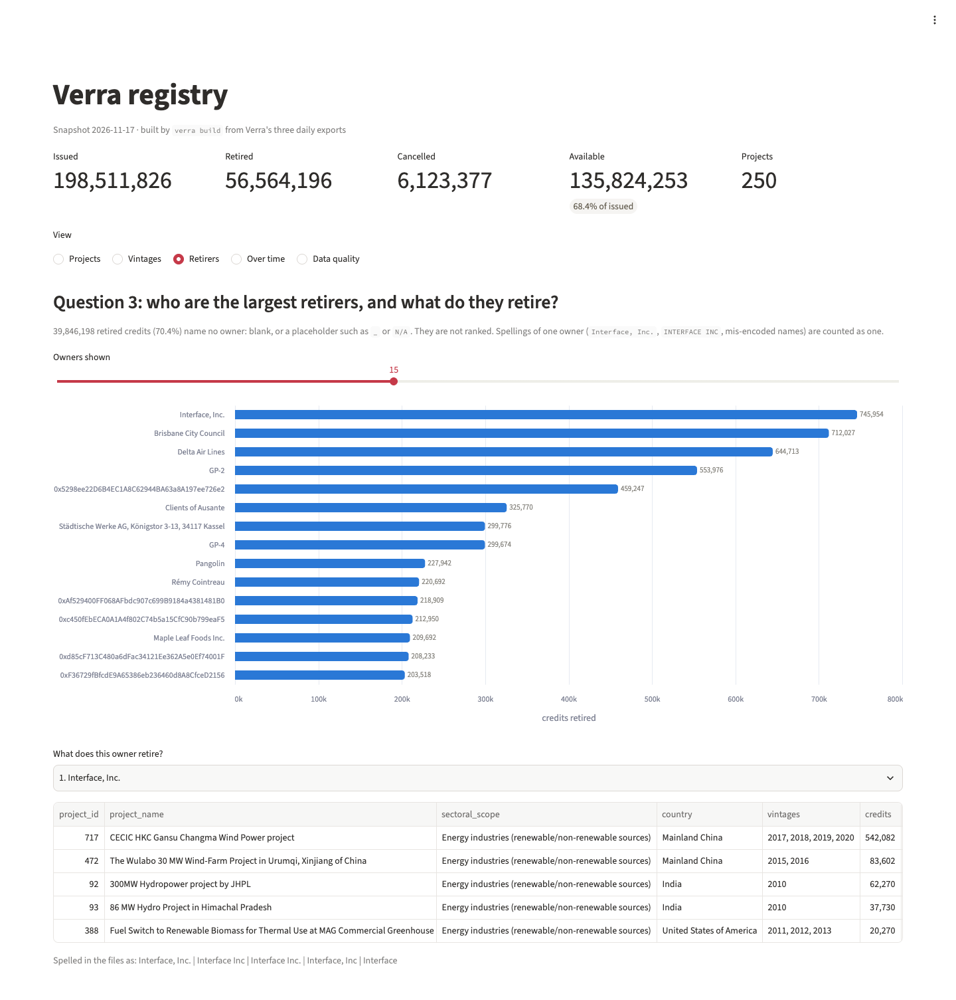
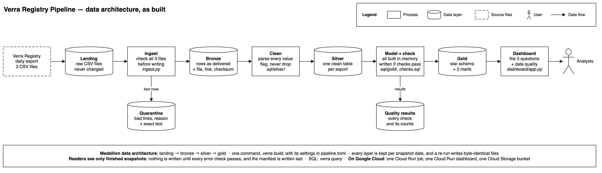
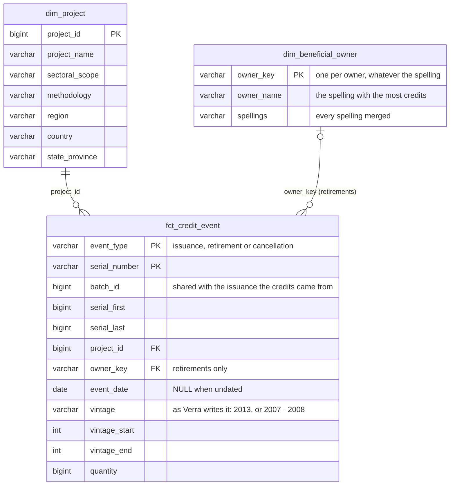
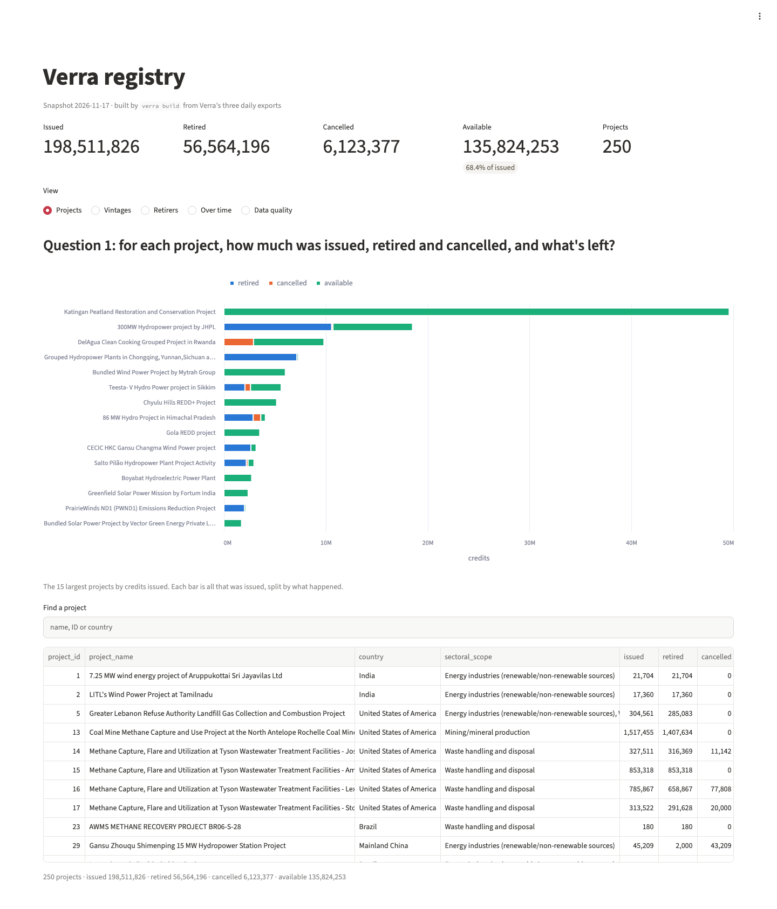
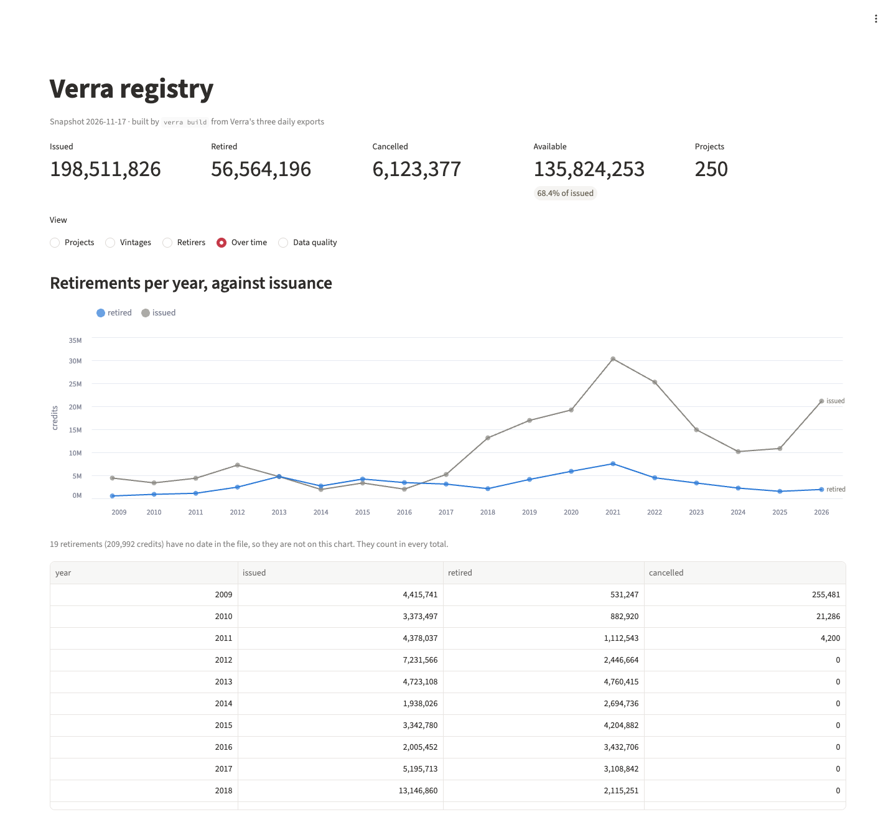
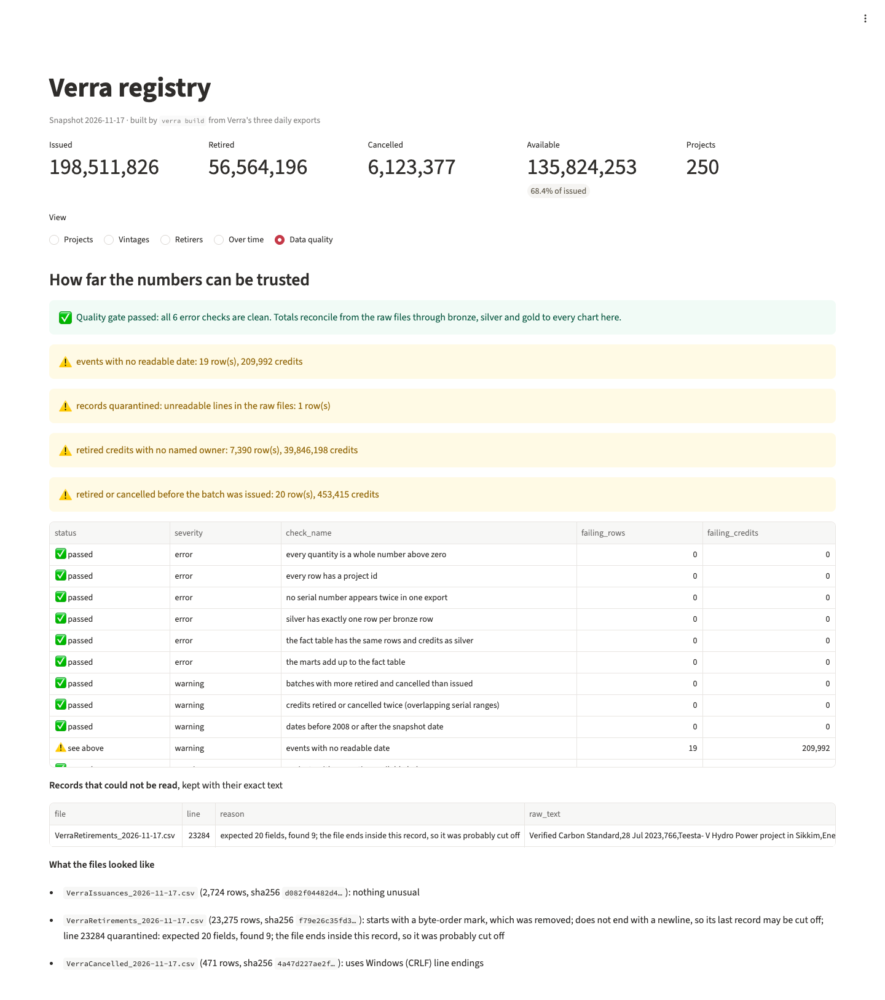
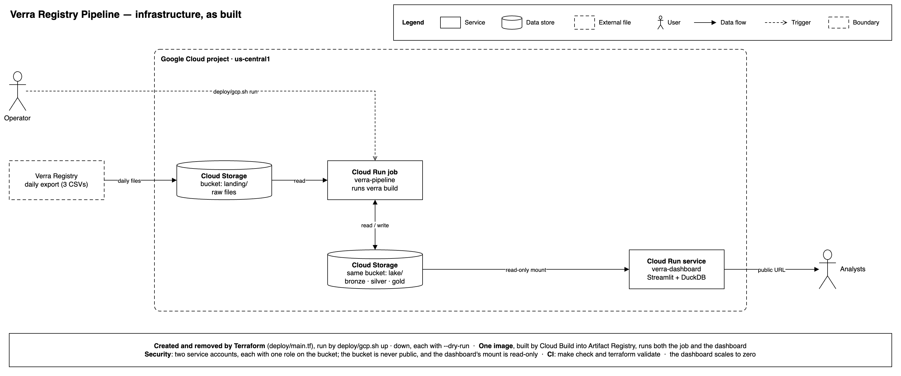

# Verra Registry Pipeline

Turns Verra's three daily registry exports into a clean, tested data model, with a dashboard that answers three questions:
1. For each project: how much was issued, retired and cancelled, and how much is still available?
2. How does credit activity break down by vintage?
3. Who are the largest retirers, and what do they retire?

**Live demo:** not deployed yet. `deploy/gcp.sh up` creates it ([Cloud demo](#cloud-demo)), and its URL goes here.



**Contents**
1. [Quick start](#quick-start)
2. [The answers for the 2026-11-17 snapshot](#the-answers-for-the-2026-11-17-snapshot)
3. [Running it on another snapshot](#running-it-on-another-snapshot)
4. [How it works](#how-it-works)
5. [The data model](#the-data-model)
6. [What the data analysis found](#what-the-data-analysis-found)
7. [Decisions, and the alternatives rejected](#decisions-and-the-alternatives-rejected)
8. [Assumptions](#assumptions)
9. [The quality gate and the tests](#the-quality-gate-and-the-tests)
10. [The dashboard](#the-dashboard)
11. [Cloud demo](#cloud-demo)
12. [What's next](#whats-next)
13. [Documentation](#documentation)
14. [Layout](#layout)

Each section is a summary. The detail behind it is in a short page in [`docs/`](#documentation).

## Quick start

You need [uv](https://docs.astral.sh/uv/). It installs Python 3.13 if it's missing.

```bash
make setup       # create .venv with the locked dependencies
make build       # the one command: raw files to bronze, silver and gold, behind a quality gate (about 1 second)
make dashboard   # http://localhost:8501
make check       # lint, type-check and run the 51 tests
```

Without `make`: `uv sync`, then `uv run verra build`, then `uv run streamlit run dashboard/app.py`.

With Docker instead (it needs neither uv nor Python):

```bash
docker build -t verra .
docker run --rm --user "$(id -u):$(id -g)" -v "$PWD/data/landing:/data/landing:ro" -v "$PWD/lake:/data/lake" verra \
    verra build --landing /data/landing --lake /data/lake
docker run --rm -p 8080:8080 -v "$PWD/lake:/data/lake:ro" verra      # http://localhost:8080
```

The build prints what it read and what the quality gate saw:

```
Snapshot 2026-11-17 from data/landing

  issuances        2,724 read    2,724 loaded   0 quarantined
  retirements     23,276 read   23,275 loaded   1 quarantined
  cancellations      471 read      471 loaded   0 quarantined

Findings
  VerraRetirements_2026-11-17.csv: starts with a byte-order mark, which was removed
  VerraRetirements_2026-11-17.csv: does not end with a newline, so its last record may be cut off
  VerraRetirements_2026-11-17.csv: line 23284 quarantined: expected 20 fields, found 9; the file ends inside this record, so it was probably cut off
  VerraCancelled_2026-11-17.csv: uses Windows (CRLF) line endings

Quality gate passed: all 6 error checks are clean
  warning: events with no readable date: 19 row(s), 209,992 credits
  warning: records quarantined: unreadable lines in the raw files: 1 row(s)
  warning: retired credits with no named owner: 7,390 row(s), 39,846,198 credits
  warning: retired or cancelled before the batch was issued: 20 row(s), 453,415 credits

Credits: issued 198,511,826 · retired 56,564,196 · cancelled 6,123,377 · available 135,824,253
```

To query the model directly: `make query SQL="select * from gold.mart_project_balance order by issued desc limit 5"`.

## The answers for the 2026-11-17 snapshot

| | |
|---|---|
| Projects | 250: 110 have retirements, 33 have cancellations |
| Issued | 198,511,826 credits |
| Retired | 56,564,196 |
| Cancelled | 6,123,377 |
| Still available | 135,824,253 (68.4% of issued) |
| Largest retirers | Interface, Inc. 745,954 · Brisbane City Council 712,027 · Delta Air Lines 644,713 |
| Retired credits with no named owner | 39,846,198 (70.4%) |
| Issued credits with a multi-year vintage | 33,573,921 (16.9%) |

`tests/test_real_snapshot.py` checks these numbers on every run. Each one was first worked out independently, line by line, in the data analysis.

**How we know they're right:**
1. **Nothing is lost on the way in.** For every file, the records read equal the records loaded plus the ones quarantined, and every row keeps its file, line and checksum.
2. **Every layer adds up.** Silver has one row per bronze row, the fact table equals silver, and every mart adds up to the fact table. If not, nothing is written.
3. **Every retired credit traces back to an issuance:** each one lies inside an issued batch, and none is used twice.
4. **An independent check:** the numbers above were worked out from the raw files before the pipeline existed, and a test holds the pipeline to them.
5. **The same input gives the same bytes,** on macOS and in a Linux container.

More: [checks and tests](docs/quality.md).

## Running it on another snapshot

Put the three files in `data/landing/` with the same names (`VerraIssuances_<YYYY-MM-DD>.csv`, `VerraRetirements_<YYYY-MM-DD>.csv`, `VerraCancelled_<YYYY-MM-DD>.csv`) and run `make build`.
- **Which date:** the newest date that has all three files.
- **Other choices for one run:**
  - `uv run verra build --snapshot 2026-11-17` picks a date;
  - `--landing <folder>` reads another folder;
  - `--lake <folder>` writes elsewhere.
- **Every snapshot is kept** in its own folder (`snapshot_date=…`). SQL and the dashboard show the newest one that finished building.

What happens to input it can't trust:

| The input | What happens |
|---|---|
| A date with a file missing | That date is skipped, and the newest complete date is built; the report names the date. It's an error only when no date is complete, or when `--snapshot` asks for that date. |
| A required column missing, or a file mostly unreadable (over 1% of its lines) | The run stops with one clear sentence and writes nothing. |
| A record that can't be read (a cut-off last line, a broken quote) | It goes to `bronze.rejected_records` with its reason and exact text, and the run carries on. |
| A renamed header | One alias line in `pipeline.toml` maps it to the old name. |
| A value that can't be read (a date, a number, a serial) | It becomes NULL in silver. The quality gate stops the build if a number would be wrong; otherwise it warns. |

More: [how a build works](docs/pipeline.md).

## How it works



Medallion layers, one Parquet file per table and snapshot date, under `lake/`:
- **Landing:** the raw files, only ever read. Each file's SHA-256 checksum is recorded.
- **Bronze:** every record exactly as delivered, all text, plus where it came from: snapshot date, file, line and checksum. Records that can't be read go to `rejected_records`, with their exact text.
- **Silver:** one clean table per export, one row per bronze row. Values are typed, trimmed and repaired. A value that can't be read becomes NULL; nothing is dropped.
- **Gold:** a star schema, three marts (one per question) and `quality_results`.

**One command builds everything inside one in-memory DuckDB database:**
1. `ingest` reads and checks the files, then loads bronze;
2. `transform` runs the SQL in `sql/` to build silver and gold, then the quality checks;
3. only then are bronze, silver and gold written, each file atomically (a temporary name, then a rename), with the manifest last.

A failed check leaves the lake exactly as it was. Readers (`verra query`, the dashboard) see only snapshots that have a manifest, so a half-written build is never visible. The same input always gives byte-identical files, on macOS and in the Linux container alike.

**Where things live:**
- **`pipeline.toml`:** where the files are, how they're named, the reject budget, and the columns each export must have.
- **`sql/`:** what the data means: the macros, silver, gold and the checks.
- **Python** (`src/verra_pipeline/`, about 590 lines): how to read untrusted CSV, write atomically and run the steps.

More: [how a build works](docs/pipeline.md), step by step, and [the architecture](docs/architecture.md), with the production design it was cut down from.

## The data model



The three marts are built from this star, one per question; the table says how.

| Table | One row per | Key | How it relates |
|---|---|---|---|
| `gold.fct_credit_event` | issuance, retirement or cancellation | `event_type` + `serial_number` | `project_id` → `dim_project`. `owner_key` → `dim_beneficial_owner` (retirements). A retirement or cancellation has the same `batch_id` and `project_id` as its issuance, and a serial range inside the issuance's range. |
| `gold.dim_project` | project | `project_id` | Each project's most common combination of details: methodology and country can differ between batches. |
| `gold.dim_beneficial_owner` | owner, spellings merged | `owner_key` | `unspecified` holds blank and placeholder owners. |
| `gold.mart_project_balance` | project | `project_id` | **Q1:** issued, retired, cancelled, available. |
| `gold.mart_vintage_activity` | vintage, as written | `vintage` | **Q2:** with `vintage_start` and `vintage_end` for charts. |
| `gold.mart_top_retirers` | owner and project | `owner_key` + `project_id` | **Q3:** `owner_rank` ranks named owners; credits, vintages and dates for each project. |
| `gold.quality_results` | quality check | `check_name` | What the gate measured on this snapshot. |
| `silver.issuances`, `silver.retirements`, `silver.cancellations` | one per bronze row | `_source_file` + `_source_line` | Typed and cleaned; the fact table stacks them. |
| `bronze.*` | raw record | `_source_file` + `_source_line` | Exactly as delivered, plus lineage. |

Every credit total is `sum(quantity)` over the fact table, and available = issued − retired − cancelled.

More: [the data model](docs/data-model.md): how each value is read, how owner spellings are merged, and example queries.

## What the data analysis found

Before any cleaning was written, every line of the three files was read and profiled: encodings, line endings, every column's values, and how the files link. These findings shaped the pipeline most:

| Found in the files | How it's handled |
|---|---|
| Retirements start with a byte-order mark and end in a cut-off record; cancellations use Windows line endings | Bronze reads all of it; the cut-off record goes to quarantine with its exact text |
| 7 retirement records hold a line break inside a quoted field | The CSV reader follows the quotes and records the line each record starts on |
| Two date formats: `19 Mar 2009`, and `01-Apr-09` in cancellations | `parse_date` reads both; anything else becomes NULL, and the gate counts it |
| 19 retirements have no date (209,992 credits); Verra flags them itself | Kept in every total; shown as "undated"; a warning |
| 16.9% of issued credits have a multi-year vintage (`2007 - 2008`) | `vintage_start` and `vintage_end`; charts count a range in its first year and say so |
| A serial number starts with the batch number and the range; quantity = last − first + 1 on every row | Every retirement and cancellation is traced to its issued batch: no credit is used twice, and none comes from nowhere |
| 70.4% of retired credits name no owner: blank, `_`, `-`, `N/A`, `Other` | Grouped as `unspecified`, left out of the ranking and stated on the dashboard |
| One owner, many spellings: case, punctuation, legal form, mis-encoded text (`Städtische` for `Städtische`) | Names are repaired and given an `owner_key`. Without it, Delta Air Lines ranks first and the placeholder `_` fifth; with it, Interface, Inc. is first. |
| A naive cleaning rule would blank Chinese company names | The key keeps letters of every alphabet |

More: [the data analysis](docs/data-analysis.md): every finding and the decision it led to, the reference numbers, and what was left alone on purpose.

## Decisions, and the alternatives rejected

| Decision | Why | Rejected |
|---|---|---|
| Medallion layers, every snapshot kept | Every number traces back to a raw line; yesterday stays queryable | Overwriting one set of tables each day |
| DuckDB, inside the process | About 10 MB a day: it reads and writes Parquet natively, with nothing to run or pay for | Spark: a cluster's start-up time, cost and operations buy nothing at this size |
| Parquet files plus DuckDB views made on demand | Files stay byte-identical; nothing locks the lake while the dashboard reads it | A saved DuckDB file: its bytes change on every write, and only one process can write it |
| Everything built in memory, then written | A failed check writes nothing (integrity rule 6) | Writing each layer as it's made |
| SQL for meaning, Python for mechanics | The model reads as SQL; the CSV handling and writing are tested Python | dbt: a second tool and its setup for about 350 lines of SQL |
| One fact table for all three kinds of event | Balances are sums by kind, and the gate compares one table with silver | Three fact tables; the 3NF model of the earlier design (`docs/architecture.md`) |
| Flag, never drop | The totals reconcile; problems are counted, not hidden | Filtering bad rows in silver |
| Errors stop the build only when a number would be wrong | Warnings (undated rows, no owner) are facts about Verra's data, not reasons to publish nothing | Failing on every oddity |
| Owner names merged by a key | Q3's ranking depends on it | Fuzzy matching: hard to explain, and it can merge different companies |
| Settings in `pipeline.toml` | A renamed header or new folder is a settings change, not a code change | Hard-coded columns; a JSON Schema registry (in the earlier, heavier version) |
| Terraform for the cloud demo, run by a short script | `down` deletes exactly what `up` made, from Terraform's record, and the plan shows every change before it happens | gcloud commands alone: `down` must list by hand everything `up` made |

More: [decisions, alternatives and limits](docs/decisions.md): the reasoning, what happens when Verra changes its files, and the shortcuts taken on purpose.

## Assumptions

- **Each daily file is the full history, not one day's changes.** The dates run from 2009 to the day before the snapshot. So each build rebuilds the snapshot rather than appending.
- **Available = issued − retired − cancelled.** The files don't cover buffer pools or transfers between accounts.
- **A multi-year vintage counts in its first year in charts by year.** The files don't say how it splits; the marts keep the exact label.
- **A blank or placeholder owner is "unspecified".** The spellings of one owner differ only in case, accents, punctuation or a legal form at the end. Names that differ more stay apart.
- **Undated retirements count in every total**; they're missing only from charts over time.
- **A serial number is unique within one export.** A duplicate stops the build, because it would count credits twice.
- **The date in the file name is the snapshot date.**

## The quality gate and the tests

`sql/checks.sql` runs after gold is built and before anything is written. Its result is kept in `gold.quality_results` and shown on the dashboard.

**Error checks** (a number would be wrong, so the build stops):
- silver has exactly one row per bronze row;
- every quantity is a whole number above zero (`12.5` stops the build; it isn't rounded to 13);
- every row has a project;
- no serial number appears twice in an export;
- the fact table has the same rows and credits as silver;
- every mart adds up to the fact table.

The marts join the dimensions, so the last check also proves no event points at a missing project or owner.

**13 warnings** report facts about Verra's data, and the build goes on: unreadable records, dates and serials, credits outside every batch or used twice, negative balances, and retirements with no named owner. Four fire on this snapshot: 1 quarantined record, 19 undated retirements, 20 retirements dated before their batch was issued, and 7,390 retirements with no named owner.

**51 tests** (`make check`, also run by GitHub Actions on every push) cover the real files' quirks and six kinds of broken input refused with nothing written, every macro and owner key, a failed gate writing nothing, byte-identical rebuilds, every number in the answers above, every dashboard view, and the deploy's dry runs. The risky lines were mutation-checked: broken on purpose, to confirm a test fails.

More: [checks and tests](docs/quality.md): every check and today's result, each integrity rule with the test that proves it, and the tests file by file.

## The dashboard

`make dashboard` serves it at http://localhost:8501. Five views, each with its own address (`?view=Retirers`):

| Projects (Q1) | Vintages (Q2) |
|---|---|
|  |  |
| **Over time** | **Data quality** |
|  |  |

Stacked bars show what happened to issued credits, in the same three colours everywhere. Every chart has a table under it, and the headline numbers are the totals the quality gate checked.

More: [the dashboard](docs/dashboard.md): what each view answers, how the charts were chosen, and what makes it safe as a public page.

## Cloud demo



The same image runs on Google Cloud: a Cloud Run job builds the lake in a Cloud Storage bucket, and a public Cloud Run service serves the dashboard. Terraform (`deploy/main.tf`) creates and deletes every resource, and `deploy/gcp.sh` runs it. It needs `gcloud`, `terraform` and a project of your own:

```bash
GCP_PROJECT=<your-project> deploy/gcp.sh up --dry-run    # Terraform's plan: what it would do; changes nothing
GCP_PROJECT=<your-project> deploy/gcp.sh up              # create or update; Terraform shows the plan and waits for "yes"
GCP_PROJECT=<your-project> deploy/gcp.sh run             # upload data/landing and run the pipeline
GCP_PROJECT=<your-project> deploy/gcp.sh down            # delete everything up created, after the same "yes"
```

The gcloud default project is never used, nothing changes until you type `yes` to Terraform's plan, and `down` deletes everything `up` made. It hasn't been deployed yet, so writes through the bucket mount, the public URL and Cloud Build's permissions are still unproven.

More: [the cloud demo](docs/deploy.md): what it creates, the two sign-ins, the safety rules, and what to do if something fails. The production design it was cut down from is in [the architecture](docs/architecture.md).

## What's next

- **Stream large files.** The reader holds a whole file in memory, about 15 times its size. That's fine up to roughly 100 MB a file (`shortcut:` in `ingest.py`).
- **Read owners from Retirement Reason Details.** 1,214 retirements with no owner say "on behalf of …" there. Interface alone has another ~700,000 credits written that way.
- **Split the multi-value fields** (scopes, methodologies, labels) against a list of the known values, since single values contain commas.
- **Map countries to ISO codes.** The 2-letter code inside the serial is often wrong, so it can't be used as is.
- **Compare snapshots day to day:** what changed, which retirements appeared, which records were restated.
- **Run it daily on its own:** Cloud Scheduler or Eventarc, then the production design's run catalog, alerts on new warnings and BigQuery.
- **Spread multi-year vintages across their years,** if Verra's per-year data becomes available.

The shortcuts taken on purpose, and when to undo each, are in [decisions, alternatives and limits](docs/decisions.md#known-gaps-and-shortcuts).

## Documentation

Short pages in `docs/`, each one the detail behind a section above:

| Page | What it covers |
|---|---|
| [How a build works](docs/pipeline.md) | The steps, reading files without trusting them, all-or-nothing writes, the lake, byte-identical output |
| [The data model](docs/data-model.md) | How each value is read, how owner spellings are merged, how each mart is made, example queries |
| [The data analysis](docs/data-analysis.md) | What the three files really contain, the decision each finding led to, the reference numbers |
| [Checks and tests](docs/quality.md) | Why the numbers can be trusted: the 19 checks and today's results, each integrity rule with its test |
| [Decisions, alternatives and limits](docs/decisions.md) | The reasoning behind each choice, what happens when Verra changes its files, the known gaps |
| [The dashboard](docs/dashboard.md) | What each view answers, how the charts were chosen, what makes it safe as a public page |
| [The cloud demo](docs/deploy.md) | What Terraform creates, how to deploy it, the safety rules, what to do if something fails |
| [The architecture](docs/architecture.md) | As built against the production design, with diagrams, and the path to production |

## Layout

```
pipeline.toml          settings: paths, file names, reject budget, columns per export
src/verra_pipeline/    the pipeline: ingest.py, transform.py, lake.py, config.py, cli.py
sql/                   the model: macros.sql, silver/, gold/, checks.sql
dashboard/app.py       the Streamlit dashboard
tests/                 51 tests; tiny fixture files dated 2030-01-15, plus the real snapshot
deploy/main.tf         the cloud demo's resources, in Terraform
deploy/gcp.sh          runs it: up, run, down
Dockerfile             one image for the job and the dashboard
docs/                  the detail behind this README, architecture diagrams (draw.io and PNG), screenshots
data/landing/          the raw Verra files, never modified
lake/                  generated by `make build` (git-ignored; `make clean` deletes it)
```

**Scope.** The brief asks for about 2–4 hours and says it doesn't expect a production system. The core is small: the pipeline (about 590 lines of Python and 360 of SQL), the dashboard and the tests. The data analysis, the quality gate and the cloud demo go further, because the brief says the numbers being right matters most, and they're what proves it.
