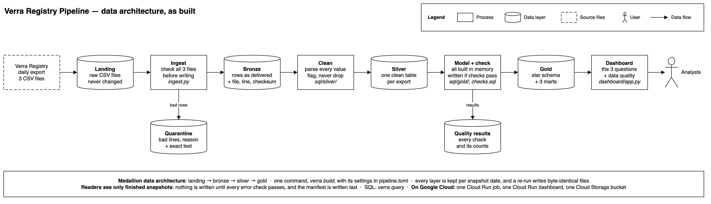
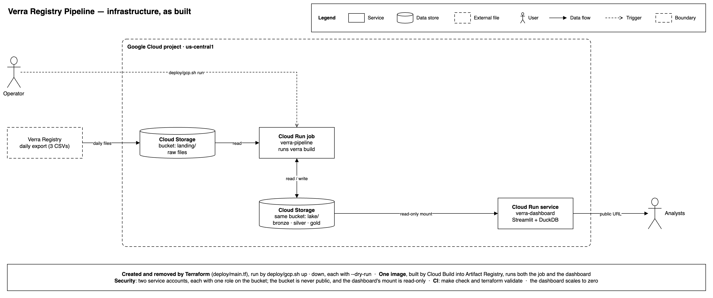
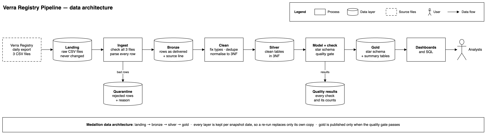
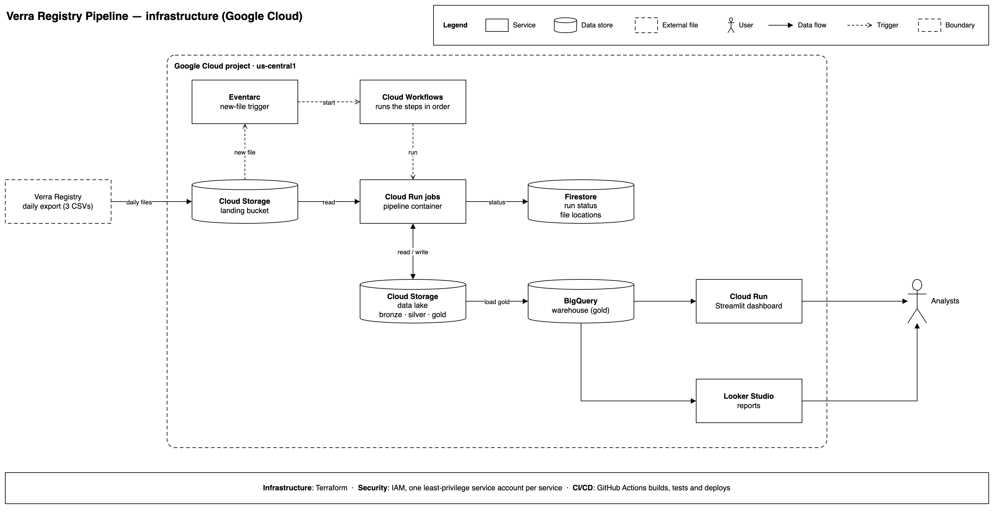

# Architecture

Two designs, drawn the same way so they compare page by page:
- **As built** (`architecture/verra-pipeline-as-built.drawio`): what this repository runs, locally and as the cloud demo.
- **Production** (`architecture/verra-pipeline.drawio`): where it would go with daily automation, many users and a team.

Boxes that appear in both sit in the same places. Open them in [app.diagrams.net](https://app.diagrams.net) (File → Open from → Device); each has a data page and an infrastructure page.

How a build works, step by step, is in [the pipeline](pipeline.md); how to deploy the demo, in [the cloud demo](deploy.md).

## Principles

1. **Raw files are evidence.** They're only read; their checksums are recorded, and every row keeps its file and line.
2. **Check everything, then write.** The whole build runs in memory, and nothing is written until every check has passed.
3. **Readers see only finished snapshots.** The manifest is written last; a snapshot without one stays hidden.
4. **Same input, same bytes.** One thread, sorted output, no timestamps, pinned versions: macOS and Linux build identical files.
5. **Flag, never drop.** Counts reconcile from bronze to the marts; problems are counted and shown, not filtered away.
6. **Settings are data, meaning is SQL, mechanics are Python.** `pipeline.toml`, `sql/`, `src/`.
7. **The least machinery that keeps those promises.** Each piece of the production design is added when its reason appears, not before.

## As built

## Production design

## The demo against the production design

The shape is the same: Cloud Run for compute, a Cloud Storage lake, a Streamlit dashboard, least-privilege service accounts. What the demo leaves out only pays off with daily automation, many users or a team. Each piece can be added back on its own.

| Piece | Production design | The demo | When to add it |
|---|---|---|---|
| Starting a run | Eventarc, when a file lands | `deploy/gcp.sh run` uploads the files and starts the job | Daily drops with nobody watching |
| Ordering the steps | Cloud Workflows | One Cloud Run job runs `verra build`, every step in order | Steps that need their own retries, timeouts or alerts |
| Storage | A landing bucket and a lake bucket | One bucket with `landing/` and `lake/`, mounted as a folder | Different access rules or retention for raw files |
| Run record | Firestore: run status, file locations | The manifest in the lake | A history of runs and restatements; audits |
| Serving gold | BigQuery | DuckDB inside the dashboard, reading the Parquet files | Many users, far more data, analysts writing their own SQL |
| Dashboards | Streamlit and Looker Studio | Streamlit on Cloud Run: public, scales to zero, at most 2 instances | Business users building their own reports |
| Creating and removing | Terraform, its record (state) kept in a bucket, one project per environment | Terraform (`deploy/main.tf`), its record kept on your machine, run by `deploy/gcp.sh up · down`, each with `--dry-run` | A team, several environments, reviewed infrastructure changes |
| Image | Built and deployed by CI | Built by Cloud Build during `up`, when a file it's made from has changed | Frequent releases |
| CI | Builds, tests and deploys | Runs `make check` on every push | Frequent releases by several people |

## The path to production

1. **Schedule it.** Eventarc on the landing bucket (or Cloud Scheduler) starts the job when a full drop has arrived.
2. **Record every run.** A run catalog (Firestore or a small table) holds each run's status, input checksums and gate results. Alerts go out on a failed gate or a new warning.
3. **Serve gold from BigQuery.** Load each finished snapshot's gold Parquet files, then point Looker Studio and analysts at it. The marts already carry their grain and keys.
4. **Share the infrastructure.** `deploy/main.tf` already describes the demo. Its record (state) moves into a versioned bucket so a team can share it, and dev and prod get their own projects.
5. **Deploy from CI.** After `make check`, GitHub Actions shows Terraform's plan on each pull request and applies it on merge.
6. **Scale the reader** once files pass about 100 MB: stream them instead of holding them in memory (the `shortcut:` in `ingest.py`).

## Pipeline choices, compared

| Step | Production design | As built | Why |
|---|---|---|---|
| Settings | JSON table definitions checked against JSON Schema | One `pipeline.toml` | Bronze is all text, so column names are all it needs |
| Silver | Third normal form: each entity in its own table | One clean table per export | Three questions don't need a shared entity model; 3NF adds keys and joins to build and defend |
| Cleaning | Fix types, deduplicate, normalise | Parse every value, flag problems, never drop a row | Dropping rows breaks the bronze-to-silver count check |
| Model and gate | Star schema behind a quality gate | The same, as SQL files: built in memory, written only if every error check passes | Unchanged |
| SQL access | A saved DuckDB file | Views made in memory on the newest finished snapshot | A DuckDB file's bytes change on every write, and only one process can write it |

## What the first version had, and why it went

The first version (git commit `7f4be62`) took about 4,000 lines to load bronze: 1,994 of Python, 1,455 of tests and 553 of JSON. It worked, but every line is something to read, test and fix, and the brief is a few hours' work. The rebuild keeps every guarantee and its test:

| First version | Now | Why it went |
|---|---|---|
| A JSON Schema registry for the tables (527 lines of JSON, 467 of Python) | `[sources.*]` in `pipeline.toml` | It answered questions nobody asked |
| A config search across several places | One `--config` file, paths relative to it | One settings file is enough |
| One class per ingest job (reader, matcher, budget, stage) | Plain functions in `ingest.py` | The tests only ever needed the whole stage |
| Seven error classes | One `PipelineError` | Nothing caught them separately |
| A `Lake` interface with one implementation | Five small functions in `lake.py` | The cloud demo mounts the bucket as a folder, so plain paths work there too |
| A saved DuckDB warehouse file | In-memory views | Not byte-identical, and it locks out the dashboard |
| Its own table printer | DuckDB's `.show()` | The library already does it |
