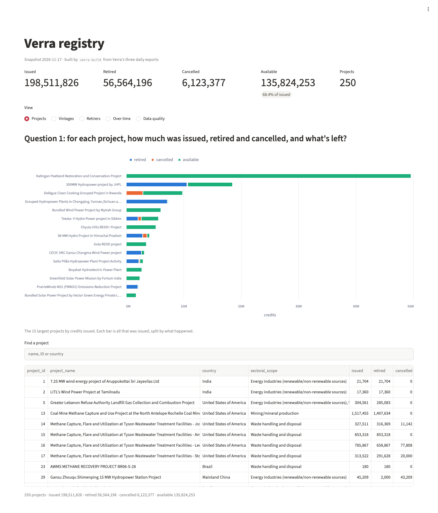

# The dashboard

`make dashboard` serves it at http://localhost:8501, on the newest finished build. It answers the brief's three questions from the gold tables, and shows how far the numbers can be trusted.

At the top, five tiles: credits issued, retired, cancelled and available, and the number of projects. Below them, five views. Each has its own address, so a link opens it directly:

| View | Address | Answers |
|---|---|---|
| Projects | `?view=Projects` | **Q1:** per project, what was issued, retired and cancelled, and what's still available. The 15 largest as bars, then all 250 in a table you can search, with totals |
| Vintages | `?view=Vintages` | **Q2:** activity by vintage year, with the share of credits in multi-year vintages worked out live |
| Retirers | `?view=Retirers` | **Q3:** the largest named retirers, what each one retires, and the spellings merged into each owner |
| Over time | `?view=Over+time` | Retirements per year, against issuance in grey |
| Data quality | `?view=Data+quality` | The gate's result, each warning, the quarantined record, and what each file looked like |

| Projects (Q1) | Retirers (Q3) |
|---|---|
|  |  |

## Where the numbers come from

- The tables read the gold marts through the same views as `verra query`.
- The tiles read the totals in the build's manifest. Those are the marts' sums, which the quality gate checked against the fact table, so the tiles and the tables can't disagree. A test holds the tiles to the model's totals.
- The data is cached until a new build finishes, and nothing locks the lake, so `make build` can run while the dashboard is open.

## How the charts were chosen

- **Part to whole:** retired, cancelled and available add up to what was issued, so each project or vintage is one stacked bar.
- **One colour per meaning, everywhere:** retired is always blue, cancelled orange, available green.
- **One colour for a ranking:** the retirers are compared with each other, so all their bars are the same colour.
- **One axis over time:** both series are credits. Issuance is grey, as the background against which retirements are read.
- **A table under every chart,** so no number lives only in a tooltip.
- **Colours checked** for colour blindness and contrast, in the light and the [dark](images/retirers-dark.png) theme. One light colour is below 3:1 contrast, so the tables carry the values.

## Built for a public page

- **Owner names are shown as plain text.** They're free text, typed into the registry by whoever retires credits. Shown as Markdown, a name like `[Claim credits](https://…)` would become a link.
- **Every view survives an unusual snapshot.** If a day's dates can't be read, or no retirement names an owner, the gate only warns, so each view says what's missing instead of crashing. The tests run every view on such a snapshot.
- **No outside calls.** `.streamlit/config.toml` turns off usage statistics, the first-run email prompt, and the welcome message's lookup of the machine's public IP address.

## Left out on purpose

- **A login:** everything shown is public registry data.
- **Filters** beyond the project search and the number of owners shown.
- **A map:** country names aren't standard codes, and the codes inside the serial numbers are often wrong.
