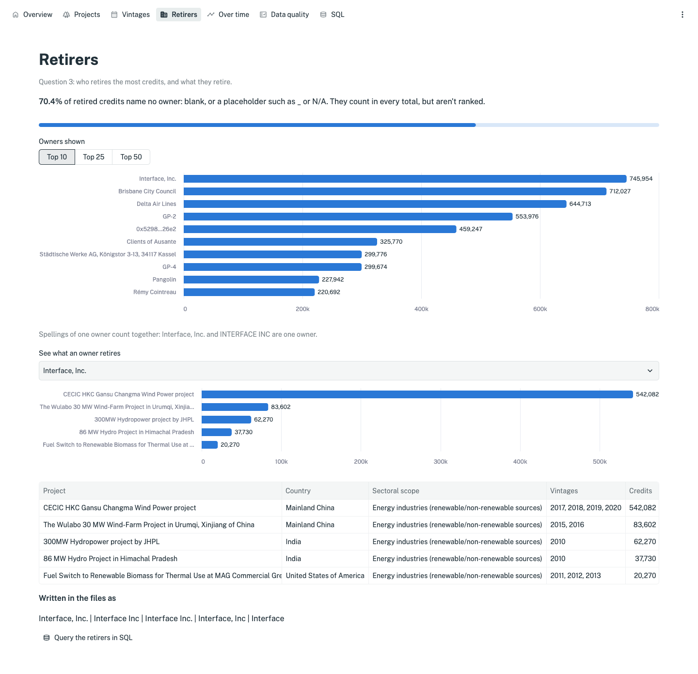
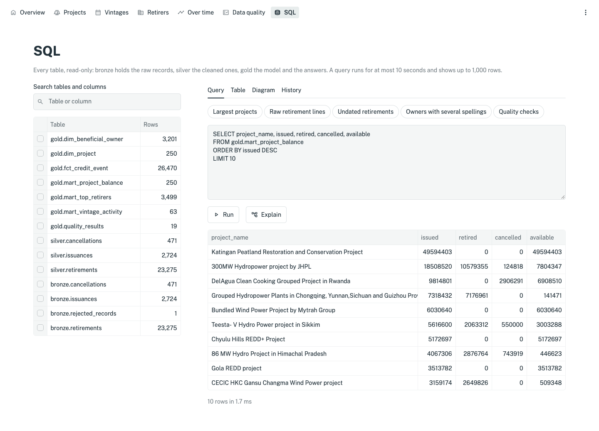

# The dashboard

`make dashboard` serves it at http://localhost:8501. It shows the newest finished build, in seven pages:

| Page | Shows |
|---|---|
| Overview | Every credit issued, as one bar split into retired, cancelled and still available. Then each question, answered in one line. |
| Projects | **Question 1:** the 15 largest projects, then all 250 in a table you can search. Pick one to see its vintages and who retired its credits. |
| Vintages | **Question 2:** activity by vintage year, in credits or as shares |
| Retirers | **Question 3:** the largest named owners. Pick one to see the projects they retire from, and the spellings merged. |
| Over time | Credits issued, retired and cancelled per year, or as running totals |
| Data quality | The quality gate's checks, the records that couldn't be read, and the files |
| SQL | Any query on any table, read-only ([below](#the-sql-page)) |

Each page has its own address, such as `/retirers`. A query can travel in the address too: `/sql?sql=SELECT count(*) FROM gold.dim_project` opens the SQL page and runs it.

| Overview | Retirers |
|---|---|
|  |  |

## Where the numbers come from

- **Every page reads the gold tables,** through the same views as `verra query`.
- **The headline figures come from the build's manifest,** whose totals the quality gate checked. So a chart and a table can't disagree.
- **Data is read once per build, and cached.** A new build shows on the next click.

## The chart for each question

What the data has to show picks the chart. Colour comes last.

| The data shows | Chart | Where |
|---|---|---|
| One whole in three parts | One split bar, the **ledger bar** | Overview, and each project |
| Several wholes, split the same way | Stacked bars | Projects |
| How each year splits | Stacked columns, with a switch to shares | Vintages |
| One share that limits the answer | A thin meter beside its sentence | Retirers, Vintages |
| A ranking | Bars in one colour, with the value at the tip | Retirers |
| A trend, against its context | Two lines on one axis, or running totals | Over time |
| Exact values | A table under the chart | Most pages |

On every page:
- **A colour means the same thing everywhere:** retired is blue, cancelled orange, available green. They're checked for colour blindness and contrast, in light and [dark](images/retirers-dark.png) mode.
- **Hovering shows exact values.**
- **Every chart and table has a name for screen readers,** such as "Of 198.5M credits issued, 28.5% are retired…".

## The look

- **Calm and exact, numbers first,** like a public ledger. The only strong colours are the three fates of a credit.
- **One typeface, Public Sans.** The dashboard serves it, and its tab icon, itself, so it fetches nothing from outside.
- **The theme is in `.streamlit/config.toml`,** with no custom CSS.

## The SQL page

It works like a small DBeaver, the database tool:
- **Navigator:** every table, with its row count. The search finds tables by name or by column: `owner_key` finds the four tables that have it.
- **Table tab:** each column's type, empty values, distinct values and range, and the first 100 rows.
- **Diagram tab:** the star schema, drawn from the tables themselves.
- **Query tab:** Ctrl+Enter (Cmd+Enter on a Mac) runs the query. There are five examples, and **Explain** shows DuckDB's plan.
- **History:** this session's last 20 queries.
- **Results:** sort, search, full screen and CSV download.

The Projects, Vintages and Retirers pages each link to their query here, so any number can be traced to its raw lines.

**Safety.** Anyone who can open the dashboard can type SQL, so each query runs on its own in-memory copy of the tables, locked down first (`lake.lock_down`):
- it can't open a file, reach the network or load an extension, and can't switch those back on;
- it gets one thread, 256 MB and 10 seconds, and never spills to disk;
- at most 1,000 rows are shown;
- queries take turns, so a few heavy ones can't use up the cloud demo's 1 GiB;
- whatever a query changes, such as `DROP TABLE`, dies with its copy.

Each rule has a test that fails without it. Two DuckDB surprises shaped them: a query allowed into one folder could also write inside it, and switching off file access didn't stop spilling to disk.

**No indexes.** Typical queries take under 3 ms, and an index would cost more to build than it saves.

## Built for a public page

- **Owner names are shown as plain text.** Anyone can type them into the registry, and a name like `[Claim credits](https://…)` must not become a link.
- **Every page survives an odd snapshot,** such as one with no dates or no owners. It says what's missing instead of crashing.
- **No outside calls.** Usage statistics and other lookups are switched off in `.streamlit/config.toml`.

## Left out on purpose

- **A login:** everything shown is public registry data.
- **More filters:** the SQL page answers anything else.
- **A map:** the country names aren't standard codes.
- **An editor with colours and autocomplete:** it would bring a JavaScript build into the repository.
