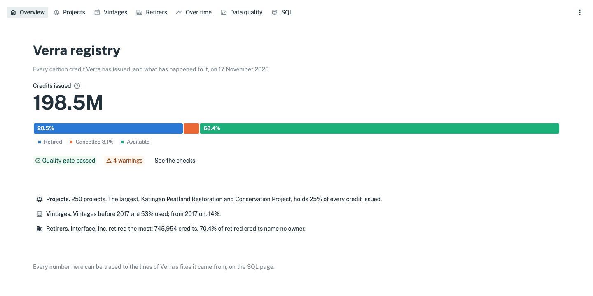

# The dashboard

`make dashboard` serves it at http://localhost:8501, on the newest finished build. It has seven pages, in a bar at the top, and each page has its own address. The pages answer the brief's three questions from the gold tables, show how far the numbers can be trusted, and let anyone query every table.

| Page | Address | What it shows |
|---|---|---|
| Overview | `/` | Every credit issued, as one bar split into retired, cancelled and still available. Then each question answered in one line, which links to its page |
| Projects | `/projects` | **Q1:** the 15 largest projects as stacked bars, then all 250 in a table you can search by name, ID or country. Pick a row to see that project's vintages and who retired its credits |
| Vintages | `/vintages` | **Q2:** activity by first vintage year, in credits or as a share of what each vintage issued, and how many credits have a vintage that spans years |
| Retirers | `/retirers` | **Q3:** how much of what was retired names no owner, then the largest named owners (10, 25 or 50). Pick an owner to see the projects they retire from, and the spellings merged into them |
| Over time | `/over_time` | Credits retired per year against credits issued, or running totals of issued and used |
| Data quality | `/data_quality` | Each check of the quality gate with its status, the records that couldn't be read, and each file with its checksum |
| SQL | `/sql` | Any query on any table, from the raw rows to the answers ([below](#the-sql-page)) |

```bash
make build && make dashboard                                        # http://localhost:8501; Ctrl+C stops it
docker run --rm -p 8080:8080 -v "$PWD/lake:/data/lake:ro" verra     # the same, from the image (docker build -t verra .)
```

A query can travel in the address: `http://localhost:8501/sql?sql=SELECT count(*) FROM gold.dim_project` opens the SQL page and runs it.

| Overview | Retirers (Q3) |
|---|---|
|  |  |

## The overview, on the 2026-11-17 snapshot

> **198.5M credits issued:** 28.5% retired, 3.1% cancelled, 68.4% still available.
>
> **Projects.** 250 projects. The largest, Katingan Peatland Restoration and Conservation Project, holds 25% of every credit issued.
> **Vintages.** Vintages before 2017 are 53% used; from 2017 on, 14%.
> **Retirers.** Interface, Inc. retired the most: 745,954 credits. 70.4% of retired credits name no owner.

Each line is worked out from the snapshot on screen, so on another snapshot it says what that one shows. The vintages line splits the years where half of all credits had been issued.

## Where the numbers come from

- **The pages read the gold tables** through the same views as `verra query`.
- **The headline figure and the ledger bar read the build's manifest.** Its totals are the marts' sums, which the quality gate checked against the fact table, so a chart and a table can't disagree. A test holds them to the model's totals.
- **Everything is read once per build and cached.** The cache is keyed by the newest manifest, so a new build shows on the next click. Nothing locks the lake, so `make build` can run while the dashboard is open.

## The chart for each question

Each chart was picked with the rule of the dataviz skill, which comes with Claude Code: what the data has to show picks the form, and colour comes last.

| What the data has to show | Form | Where |
|---|---|---|
| One whole in three parts: what happened to every credit issued | One segmented bar, the **ledger bar**, with each share printed where it fits | Overview, and each picked project |
| Several wholes, each split the same way | Stacked bars: retired, cancelled and available add up to issued | Projects (the 15 largest) |
| How each year's whole splits | Stacked columns, with a switch to shares. In credits, recent vintages dwarf old ones and hide that old vintages are used up | Vintages |
| One share that limits the answer | A meter: a thin bar beside its sentence | Retirers (no owner named), Vintages (spans years) |
| A ranking | Ranked bars in one colour, with the value at the tip | Retirers, and each project's retirers |
| One series over time, against its context | Two lines on one axis: the story in colour, issued in grey. Or running totals, where the gap between the lines is what's still available | Over time |
| Exact values, and looking one up | A table under every chart, with a bar per row for the share used | Every page |

Rules that hold on every page:
- **The same three colours mean the same three fates:** retired is blue, cancelled orange, available green. They're the first three colours of the dataviz skill's palette, checked with its validator for colour blindness and contrast, in the light and the [dark](images/retirers-dark.png) theme. One light colour is below 3:1 contrast, so the tables carry the values.
- **Text is in the text colour, never a series colour.** The coloured mark beside a label carries the meaning.
- **Hover shows exact values:** a tooltip on every bar, and a crosshair on the lines.
- **Every chart and table has an accessible name** that states what it shows, such as the ledger bar's "Of 198.5M credits issued, 28.5% are retired…". A test reads it.

## The look

- **One idea, a public ledger:** calm and exact, numbers first. The only strong colours are the three fates of a credit. Buttons and navigation use the text colour, so nothing competes with the data.
- **One typeface, Public Sans,** from the US government's design system, with clear figures for numbers. It's served from `dashboard/static/`, so the dashboard still fetches nothing from outside.
- **The theme is in `.streamlit/config.toml`:** colours, fonts and chart palettes, for light and dark. There's no custom CSS.
- **No generic dashboard tells,** from the [frontend-design skill](https://github.com/anthropics/skills)'s list: no wall of number tiles, no emoji, no details strung together with dots, no gradients.

## The SQL page

It follows DBeaver, the database tool, in less space:

| DBeaver | Here |
|---|---|
| A database navigator, with search | Every table, gold first, with its row count. The search matches table and column names: `owner_key` finds the four tables that have that column. Pick a table to open it |
| A table's data and its ER diagram | **Table** tab: each column's type, nulls, distinct values and range (DuckDB's `SUMMARIZE`), and the first 100 rows. **Diagram** tab: the star schema, with its columns read from the tables, so it can't drift from them |
| An SQL editor, with history | **Query** tab: Ctrl+Enter (Cmd+Enter on a Mac) or Run, five example queries, and **Explain** for DuckDB's plan. **History:** this session's last 20 queries, each one click from the editor |
| A results grid | Sort, search, full screen and CSV download, with the row count and the time taken |

The Projects, Vintages and Retirers pages each link to their query here, so any number can be traced down to its raw lines.


**No indexes.** On the real snapshot, typical queries take 0.7–2.5 ms. Building an index takes 15 ms, on a copy that lives for one query, so it would cost more than it saves. DuckDB already keeps the smallest and largest value in each block of a column, and skips the blocks that can't match. What a SQL panel does need is a catalogue of what exists, and that's the navigator and its search.

**Guardrails.** Anyone who can open the dashboard can type SQL into it, so every query runs on its own copy of the tables, locked down first (`lake.lock_down`):
- **It can't open any file,** to read or to write, reach the network, or load an extension. A query that tries gets a "Permission Error".
- **It can't change those settings back:** they're locked before the query runs.
- **It gets one thread, 256 MB and 10 seconds,** and at most 1,000 rows are shown. A query too big for its memory fails at once; it never spills to disk.
- **Whatever it changes dies with it.** `DROP TABLE` only drops that query's own copy, so the next query sees every table again.

Two DuckDB surprises shaped this, both found by testing on a copy of the lake:
- **Allowing just the lake's folder isn't enough.** DuckDB lets a query write inside an allowed folder too, and one did, over a Parquet file the dashboard reads. So the query gets a copy of the tables in memory (50 ms, 44 MB) and no file access at all.
- **Switching file access off doesn't stop spilling.** A query bigger than its memory still wrote temporary files to the working folder. So spilling is switched off too.

Each guardrail has a test that fails when the guardrail is removed (`tests/test_dashboard.py`).

## Built for a public page

- **Owner names are shown as plain text.** They're free text, typed into the registry by whoever retires credits. Shown as Markdown, a name like `[Claim credits](https://…)` would become a link.
- **Every page survives an unusual snapshot.** If a day's dates can't be read, or no retirement names an owner, the gate only warns, so each page says what's missing instead of crashing. The tests run every page on such a snapshot.
- **No outside calls.** The font is served by the dashboard itself, and `.streamlit/config.toml` turns off usage statistics, the first-run email prompt, and the welcome message's lookup of the machine's public IP address.

## Left out on purpose

- **A login:** everything shown is public registry data.
- **Filters** beyond the searches and the number of owners shown: the SQL page answers anything else.
- **A map:** country names aren't standard codes, and the codes inside the serial numbers are often wrong.
- **An editor with colours and autocomplete:** Streamlit has none built in. A CodeMirror component would bring a JavaScript build and its tools into the repository. The text box, with Ctrl+Enter, examples, history and the navigator, gives most of the value.
