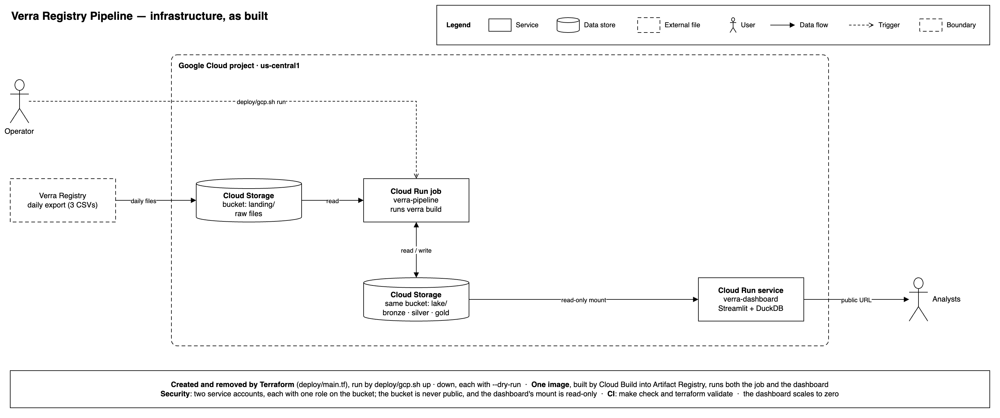

# The cloud demo

The same image runs on Google Cloud. A Cloud Run job builds the lake in a Cloud Storage bucket, and a public Cloud Run service shows the dashboard. Terraform (`deploy/main.tf`) creates and deletes it all, and `deploy/gcp.sh` runs Terraform. It's live at https://verra-dashboard-k2k4mrcqsa-uc.a.run.app.



## What it creates

- **A bucket,** `<project>-verra`, with `landing/` and `lake/`. It can never be made public.
- **An image,** built by Cloud Build into Artifact Registry. It's rebuilt only when a file it's built from changes, the README included.
- **A job, `verra-pipeline`,** that runs `verra build` on the bucket: 1 CPU, 1 GiB, at most 10 minutes.
- **A public service, `verra-dashboard`,** that reads the lake, read-only. It scales to zero, and runs at most 2 copies.
- **Two service accounts,** one for each. The job's can write to the bucket; the dashboard's can only read it.

## Deploying

You need `gcloud`, `terraform` and a Google Cloud project with billing on.

```bash
gcloud auth login                        # sign in gcloud
gcloud auth application-default login    # sign in Terraform
export GCP_PROJECT=<your-project-id>

deploy/gcp.sh up --dry-run    # show Terraform's plan (14 resources); changes nothing
deploy/gcp.sh up              # create it, after you type yes; prints the URL
deploy/gcp.sh run             # upload data/landing, build the lake, print the URL
deploy/gcp.sh down            # delete everything up made, after you type yes
```

- The first `up` takes about 2.5 minutes, 1.5 of them building the image. Timings: [the run log](run-log.md).
- Until `run` finishes, the dashboard says nothing has been built yet. Then it shows 198.5M credits issued, as it does locally.
- After a code change, run `up` again.
- `GCP_REGION` picks another region. The default is us-central1.

## Safety

- **The default gcloud project is never used.** The script stops without `GCP_PROJECT`, and every command names the project.
- **Nothing changes without a yes.** Terraform shows its plan first.
- **Dry runs change nothing.** A test checks this with fake `terraform` and `gcloud` commands.
- **Each service account has one role, on one bucket.** The dashboard's mount is read-only, so even a bug in it can't damage the lake.
- **The image build is the exception.** It runs as the project's default compute account, which Google makes an Editor on a new project. Production would give the build an account of its own.
- **The public SQL page is locked down** ([how](dashboard.md#the-sql-page)).
- **`down` deletes everything `up` made,** except the APIs it turned on, which cost nothing. Keep `deploy/terraform.tfstate` until then: it's Terraform's record of what it made.

CI checks the Terraform's format and validity on every push to main and every pull request. It never deploys.

## If something fails

| You see | Likely cause | What to do |
|---|---|---|
| Terraform can't find credentials | Terraform isn't signed in | `gcloud auth application-default login`, then `up` again |
| "API has not been used" or "service account does not exist" | A new API or account takes a minute to work everywhere | Wait a minute, then `up` again. It carries on where it stopped. |
| The image build can't push | Cloud Build lacks permission | Grant its service account `roles/artifactregistry.writer`, then `up` again |
| The job fails writing `lake/` | Writes through the bucket mount | Build in `/tmp/lake`, and copy it to the bucket at the end |
| The job says landing is empty | Uploaded folders don't show in the mount | Check that the mount has `implicit-dirs`: `gcloud run jobs describe verra-pipeline` |
| The job's log shows `BufferedWriteHandler.OutOfOrderError` | The bucket mount falls back to a slower way of writing a file DuckDB writes out of order | Nothing: the files are complete ([run log](run-log.md)) |
| The URL returns 403 | Your organisation forbids public services | `gcloud run services proxy verra-dashboard --region us-central1 --project $GCP_PROJECT`, then open http://localhost:8080 |

## What the first deploy proved

On 25 Nov 2026 ([run log](run-log.md)):
- DuckDB writes the lake through the bucket mount, and the files match a local build row for row;
- files uploaded with `gcloud storage cp` show up in the mount;
- the dashboard is public, and every page shows the same numbers as locally;
- Cloud Build pushes the image;
- a second `up` with nothing changed plans no changes.

The first `up` didn't run through in one go: a new project lacks the Cloud Resource Manager API, which Terraform's provider needs. `gcp.sh` now turns it on before Terraform runs.

The full production design is in [the architecture](architecture.md).
