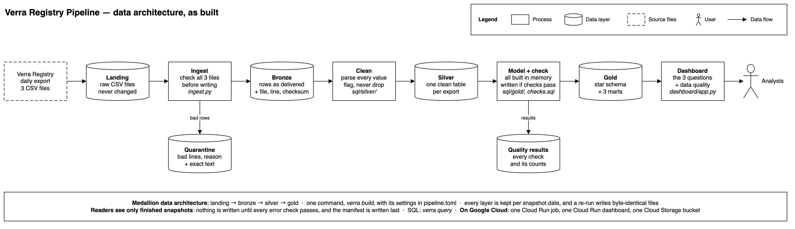

# How a build works

`make build` turns one day's three files into every table, in about a second. This page follows one build.



## The steps

1. **Find the snapshot:** the newest date that has all three files, or the date you give with `SNAPSHOT`.
2. **Read and check every file** (`ingest.py`).
3. **Load bronze** into an in-memory DuckDB database.
4. **Build silver and gold** with the SQL files in `sql/` (`transform.py`).
5. **Run the quality gate** (`sql/checks.sql`). If an error check fails, the build stops and writes nothing.
6. **Write** every table to `lake/`, and the manifest last (`lake.py`).

## Reading files it doesn't trust

- **The raw files are only read.** Each file's SHA-256 checksum goes on every bronze row.
- **Text:** UTF-8, with or without a byte-order mark, or else Windows-1252. The report notes a byte-order mark or a fallback to Windows-1252.
- **Records:** Python's `csv` module follows quotes, so a line break inside a field stays in its record. Windows and Unix line endings both work.
- **Quarantine:** a record with the wrong number of fields, such as a cut-off last line, goes to `bronze.rejected_records`, with the reason and its exact text.
- **The reject budget:** if more than 1% of a file's lines can't be read, the run stops. It counts lines, not records, because one stray quote can swallow many lines.

## Headers

Headers are matched by name, in any order: `Retirement QTY` becomes `retirement_qty`. `pipeline.toml` lists each file's required and optional columns:
- a missing required column stops the run, and names it;
- a missing optional column loads empty;
- a renamed column needs one alias line;
- a new column is kept in bronze.

## The layers

- **Bronze** keeps every value as text, exactly as delivered, plus four lineage columns: `_snapshot_date`, `_source_file`, `_source_line` and `_file_sha256`. So any number can be traced back to lines in a raw file.
- **Silver and gold** come from the SQL files, run in order: `macros.sql`, `silver/`, `gold/`. How each value is read: [the data model](data-model.md).
- **The quality gate** runs 19 checks: 6 errors that stop the build, and 13 warnings. See [checks and tests](quality.md).

## Writing: all or nothing

1. Every check runs before the first write.
2. Each file is written under a temporary name, then renamed, so no one ever reads half a file.
3. Rebuilding a day first removes its manifest, so the day stays hidden until it's whole.
4. The manifest goes last. It records the input files, their checksums, the row counts, the findings, the gate's results and the totals.
5. `verra query` and the dashboard read only days that have a manifest, and show the newest.

```
lake/
  bronze/issuances/snapshot_date=2026-11-17/data.parquet
  silver/…/snapshot_date=2026-11-17/data.parquet
  gold/…/snapshot_date=2026-11-17/data.parquet
  _manifests/snapshot_date=2026-11-17/build.json
```

Nothing locks the files, so you can build while the dashboard is open.

## Same input, same bytes

DuckDB runs on one thread, every SQL file sorts its output, nothing written holds a timestamp, and `uv.lock` pins every package. A test rebuilds and compares every file, and the Docker image on Linux gives the same 15 files as macOS.

## Commands

```bash
make build                                 # the newest complete date in data/landing
make clean build SNAPSHOT=2026-11-17       # an empty lake, then that date
uv run verra build --landing <folder> --lake <folder>
uv run verra --config other.toml build     # other settings
make query SQL="select * from bronze.rejected_records"
```

Errors are one sentence, for example: `error: the quality gate failed, so nothing was written: every quantity is a whole number above zero: 1 row(s)`.
